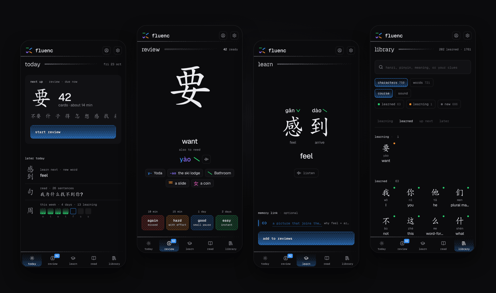

# fluenc

A Mandarin study app for reading Chinese characters, built on the Hanzi Movie Method by Mandarin Blueprint. Fluenc is an independent project and is not affiliated with or endorsed by Mandarin Blueprint.



It covers about 1,000 of the most common spoken words and the 726 characters they use. Each part is its own activity, done whenever you like:

- **Lessons** teach the next character or word whose parts you already know. You build a Hanzi Movie for each character from your actors, sets and props.
- **Review** shows everything due, scheduled with [FSRS](https://github.com/open-spaced-repetition/ts-fsrs).
- **Reading** shows sentences made almost entirely from words you know. You shadow each one aloud before it joins Review.
- **Focus** puts words from a class you're taking at the front of the queue.

Progress is stored on the device first and syncs to your account when you're online, so the app works offline once installed. A daily push notification can remind you to review.

## Stack

TanStack Start with React 19, Drizzle on Turso (libSQL), Better Auth with email and password, Tailwind 4, Workbox for offline use, and Bun for everything else. It deploys to Vercel.

## Run it locally

You need [Bun](https://bun.sh) 1.3 or later.

```sh
bun install
bun run setup
bun run dev
```

Open http://localhost:3000. `bun run setup` writes `.env` with a local SQLite database and a generated auth secret, applies the migrations, and lists which optional features are on. It never changes a value you already set, so it's safe to run again after pulling.

To see the app with real-looking progress, run `bun run db:seed` and sign in as `demo@example.com` / `demo-password`. The account has two weeks of lessons, reviews due and sentences to read. `bun run db:reset` deletes the local database and starts over. Both refuse to run against a remote database.

Everything else in `.env` is optional, and `.env.example` explains each variable:

- **Spoken audio.** `ELEVENLABS_API_KEY` and `ELEVENLABS_VOICE_ID` turn on audio for words and sentences. Single characters always play from the bundled recordings. Only signed-in users can request generated audio.
- **Audio cache.** `BLOB_READ_WRITE_TOKEN` stores generated audio in Vercel Blob, so each text is generated once. Vercel sets it in production.
- **Reminders.** `VAPID_PUBLIC_KEY`, `VAPID_PRIVATE_KEY`, `VAPID_SUBJECT` and `CRON_SECRET` turn on daily review reminders. See [Reminders](#reminders).
- **Scripts.** `FLUENC_EMAIL` sets the account that `bun run focus` uses.

VS Code suggests the Biome and Tailwind extensions and formats on save.

## Scripts

| Command | What it does |
| --- | --- |
| `bun run setup` | Write `.env`, create or update the database, list optional features |
| `bun run dev` | Start the dev server |
| `bun run verify` | Lint, type-check, test and build, the same as CI |
| `bun run check` / `bun run fix` | Lint, or lint and fix, with Ultracite (Biome) |
| `bun run typecheck` | Type-check |
| `bun test` | Run the tests |
| `bun run build` / `bun run preview` | Build the app and its service worker, then serve that build |
| `bun run db:seed` / `db:reset` | Add the demo account, or start the local database over |
| `bun run db:generate` / `db:migrate` | Create a migration after changing `src/db/schema.ts`, or apply migrations |
| `bun run focus` | Add, list or remove focus words and sentences for an account |
| `bun run data:sync` | Check the character database in `src/data/hanzi`, then rebuild the curriculum, reading sentences and stroke owners from it, and the hanzi fonts when the characters or their parts changed |
| `bun run data:font` | Rebuild the hanzi fonts by hand (needs [uv](https://docs.astral.sh/uv/)) |

`src/data/README.md` explains the character database, the teaching order and how to change them.

`public/` holds only what browsers ask for by a fixed name: icons, the manifest and licenses. Stroke files, recordings and fonts live in `assets/`, and the build publishes them under paths named by their content, so devices keep them until they change. `assets/fonts/README.md` explains how the fonts are built.

### Focus

`bun run focus add lesson.json` takes a file like this:

```json
{
  "label": "HSK 1 · L3",
  "words": [{ "hanzi": "学生", "pinyin": "xuésheng", "meaning": "student" }],
  "sentences": [{ "hanzi": "他是学生。", "pinyin": "Tā shì xuésheng.", "meaning": "He is a student." }]
}
```

Lessons teach focus words first, starting with the characters they still need. Add `--dry-run` to see what would change.

## Deploy

The app deploys to Vercel as is. `vercel.json` sets the region and the reminder cron job.

1. Create a Turso database and set `TURSO_DATABASE_URL` and `TURSO_AUTH_TOKEN`.
2. Set `BETTER_AUTH_SECRET` and set `BETTER_AUTH_URL` to your public URL.
3. Deploy with `bunx vercel deploy --prod`. Production builds apply new migrations in `drizzle/` before building; preview builds never migrate.

### Reminders

1. Generate one key pair with `bunx web-push generate-vapid-keys --json` and set `VAPID_PUBLIC_KEY` and `VAPID_PRIVATE_KEY`. Keep the same pair across deploys, because changing it makes every device subscribe again.
2. Set `VAPID_SUBJECT` to a public HTTPS URL or a `mailto:` address.
3. Set `CRON_SECRET`. Vercel sends it with the cron request to `/api/review-reminder`, which runs daily at 06:00 UTC.
4. In the installed app, open Settings, then Review reminders, and enable notifications. On iPhone this needs iOS 16.4 or later and the app added to the Home Screen.

On the Vercel Hobby plan the job can run any time within that hour, and Vercel doesn't retry failed cron runs.

## License

The code is [GPL-3.0-or-later](LICENSE). The dictionary data, sentences, stroke graphics, fonts and syllable recordings have their own licenses, listed in [THIRD_PARTY.md](THIRD_PARTY.md). The syllable recordings are licensed for non-commercial use only.
